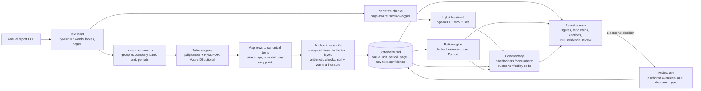

# Financial Report Intelligence

Upload a UK annual report PDF. The tool extracts the income statement and balance sheet into a
typed, audited `StatementPack`, computes locked ratios in Python, and writes commentary in which
every sentence cites a quote that code has found in the report. A language model never supplies a
number. When it cannot verify something, it shows a blank with the reason instead of a guess.

**Research aid only. Not investment advice.** Measured results, with the eval runs they come
from, are in [`docs/RESULTS.md`](docs/RESULTS.md); what it does not do is on the in-app
Limitations page and below.

## Architecture



- **Numbers** come only from the primary statements. A value counts only when its printed text is
  found on the page (anchoring), and subtotals and identities are checked. The rules are in
  [`docs/EXTRACTION.md`](docs/EXTRACTION.md).
- **Ratios** are pure functions of the pack, with the definitions locked in [`CLAUDE.md`](CLAUDE.md).
  For a bank, the corporate ratios are marked not applicable and two bank ratios are computed;
  the bank's own CET1 ratio and net interest margin are quoted as reported, never recomputed.
- **Commentary** writes numbers only as placeholders that code fills from the packs, and every
  quote is checked against the report before it is shown ([`docs/RAG.md`](docs/RAG.md)).
- More: [`docs/ARCHITECTURE.md`](docs/ARCHITECTURE.md), [`docs/UI.md`](docs/UI.md),
  [`docs/EVAL.md`](docs/EVAL.md), progress and gates in [`docs/MILESTONES.md`](docs/MILESTONES.md).

## Run it locally

Requirements: [uv](https://docs.astral.sh/uv/) (Python 3.12), Docker (for Postgres with pgvector),
Node 20.9 or later for the web app. No API keys are needed.

```bash
uv sync                 # Python environment with dev tools
make dev                # Postgres, migrations, then company_a end to end (exit 0 = ready)
```

`make dev` uses `fixtures/pdfs/company_a.pdf` if you have it, otherwise the committed excerpt of
it (the statement pages at their original page numbers). Without keys it runs on the local table
engines and writes extractive commentary (verbatim passages with citations).

Then serve the API and the report screen:

```bash
uv run finintel serve --embedder fake      # API on http://127.0.0.1:8000, with a worker
```

```bash
make web-install                           # once: Node packages and the Playwright browser
```

```bash
cd web && npm run dev                      # report screen on http://127.0.0.1:3100
```

Open http://127.0.0.1:3100, drop a PDF, or open report `1` (the one `make dev` read).

Optional services, set in `.env` (see `.env.example`): Azure Document Intelligence as a second,
image-based table engine; a commentary model (`FININTEL_PROVIDER`: local Ollama, Gemini or
Anthropic).

Checks:

```bash
make ci                 # lint, types, tests, contract drift, scope (no network)
```

```bash
make test-db            # tests against Postgres
```

```bash
make e2e                # Playwright on precomputed fixtures (no backend)
```

```bash
make e2e-live           # Playwright against the real API and worker
```

## What fails

Known failures and limits, without spin. The counts behind them are in
[`docs/RESULTS.md`](docs/RESULTS.md).

- **Small evidence base.** Two development reports, labelled by hand (one corporate, one bank),
  plus synthetic layouts. The held-out report has not been scored yet. Results are case studies,
  not an accuracy rate for annual reports in general.
- **One table-engine family in practice.** Azure Document Intelligence is supported but has not
  run on the golden reports (no key), so figures are cross-checked by arithmetic, not by a second
  independent reader. Every report says "Reduced verification".
- **Total debt is often not shown.** If the balance sheet face shows only "financial liabilities"
  (which include derivatives), borrowings cannot be isolated, so total debt and debt-to-equity are
  left empty with that reason. This happens on company_a.
- **Commentary misses.** One principal risk on company_a is dropped because the model's quote for
  it was not verbatim, so code rejected it. Two of the twenty QA questions fail. Two executive
  summary bullets were rated unsupported by a human rater: each sentence claims more than the
  quotes it cites say.
- **Not supported.** Scanned PDFs (suggestions only), NHS trusts and insurers (ratios withheld
  until a person sets the type), notes and segment tables, multi-year history, market data.
- **Local only.** One user, no accounts or access control.

## Repository rules

[`CLAUDE.md`](CLAUDE.md) holds the rules every contributor follows, including the locked ratio
definitions. Expected files in `fixtures/expected/` are written by hand from the PDFs and never by
code. The held-out report is kept out of every test until it is scored once.
