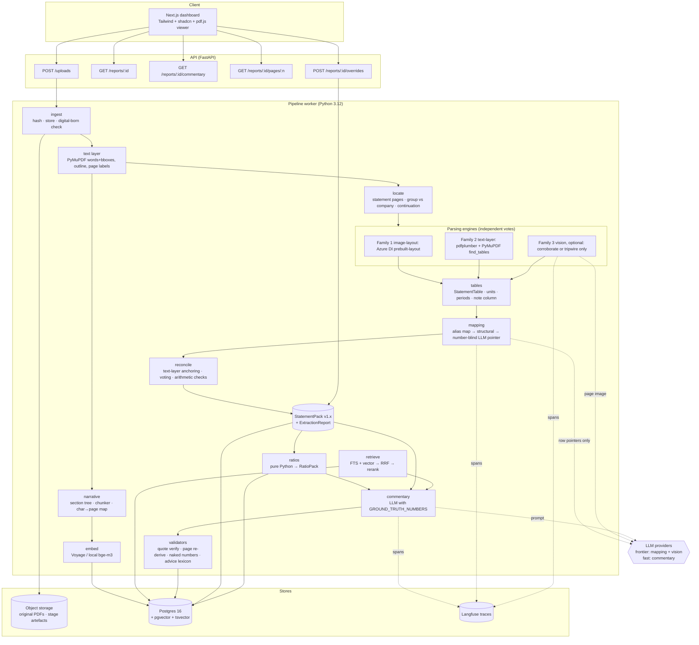

# ARCHITECTURE — Financial Report Intelligence & RAG

This document covers:
- the system as a whole
- the reasoning behind its central design choice
- what happens to one upload, including every failure path
- the chosen stack, with a local fallback for each vendor
- the decision records
- the accounting-specific threats the design defends against.

---

## 1. System diagram

**The one rule visible in the diagram:** no arrow runs from the LLM into `StatementPack` or `RatioPack` carrying a number or a decision.
- The LLM's contribution to mapping is a **row pointer that only pre-fills the review queue**. It never publishes (ADR-007).
- The vision vote returns printed strings. They count only if found in the page's text layer, and even then they can only corroborate a deterministic candidate or trip a review. They never break a tie.
- After anchoring, the **text layer**, not any engine, decides which row, column and period a number belongs to.

---

## 2. Component responsibilities

The Python package is `finintel/`. Each pipeline stage is one module with one obvious boundary. Every stage writes a content-addressed artefact keyed by `(document_sha256, stage, stage_version, config_hash)`. Re-runs are free and deterministic, and a premium parse is paid for once per document per engine version.

| Module | Responsibility | Input → Output | LLM? |
|---|---|---|---|
| `contracts/` | Pydantic models **generated** from `schemas/*.json`, with a CI drift check | JSON Schema → models | No |
| `ingest/` | SHA-256, size and encryption checks, digital-born score, store original | PDF bytes → `DocumentRecord` | No |
| `parse/text_layer` | PyMuPDF words with bounding boxes, fonts, reading-order blocks, outline, page labels | PDF → `TextLayer` | No |
| `parse/engines/*` | **v1 adapters:** `azure_di` (image-layout family), `pdfplumber` and `pymupdf_tables` (text-layer family), optional `vision`. Each returns the same normalised `ParsedTables`. (`reducto`, `llamaparse` and `docling` are v1.1.) | PDF (+ pages) → `ParsedTables` | Vision only |
| `locate/` | Score pages for each statement type; classify scope (group, company, entity) for titles **and columns**; detect continuation pages; **decide document type and whether the balance sheet is classified** (EXTRACTION §1.4) | `TextLayer` → `StatementLocation[]`, `DocumentProfile` | No |
| `tables/` | Build `StatementTable` rows and columns; detect the note column, unit, currency and period columns; parse printed numbers | `ParsedTables` + locations → `StatementTable[]` per engine | No |
| `mapping/` | Canonical-item candidates via the alias map, then structural rules. Number-blind LLM pointer suggestions are persisted separately and go **only** to the review queue. | `StatementTable` → `MappingCandidates` | Review suggestions only |
| `reconcile/` | Text-layer anchoring, cross-engine voting, arithmetic checks, confidence, threshold, warnings | candidates × engines → `StatementPack` + `ExtractionReport` | No |
| `review/` | Append-only overrides, re-materialise the pack, mark dependants stale | overrides → new pack version | No |
| `ratios/` | Pure functions: the locked v1 ratios, null reasons, period changes | `StatementPack` → `RatioPack` | **Never** |
| `narrative/` | Section tree (outline, contents page, running headers, headings); structure-aware chunking; char→page map; note-number detection | `TextLayer` (+ Azure paragraphs) → `Chunk[]` | No |
| `retrieval/` | Embeddings, Postgres full-text search, reciprocal rank fusion (RRF), rerank, section priors, evidence thresholds | query set → `RetrievedChunk[]` | No (embedding and rerank models only) |
| `commentary/` | Prompt assembly, generation, placeholder rendering, validators, retry once, persistence | packs + chunks → `Commentary` | Yes, text only |
| `llm/` | Provider adapters (Anthropic default, Gemini optional, `fake` for tests), record/replay cache, tracing | — | — |
| `storage/`, `db/` | Object store adapters (filesystem in v1; Supabase Storage / S3 in v1.1); SQLAlchemy and Alembic | — | — |
| `api/`, `worker/` | FastAPI app; Postgres jobs table using `FOR UPDATE SKIP LOCKED` | — | — |
| `evals/` | Golden cell, ratio, retrieval, commentary, coverage and QA harness; **synthetic layout generator** (EVAL E7); writes run reports | fixtures → `artifacts/eval/{run_id}/` | Judge-free by default |
| `web/` | Next.js app: one primary screen ([UI.md](UI.md)) | API → UI | No |

### 2.1 Data model (Postgres, created in M4.2 and M6.1)

The table and column names below are fixed, so the sessions that implement them don't have to invent them.

| Table | Key columns | Written by |
|---|---|---|
| `documents` | `id`, `sha256` (unique), `filename`, `page_count`, `storage_key`, `document_type`, `status` (`queued`, `processing`, `needs_unit_confirmation`, `needs_document_type`, `ready`, `failed`), `created_at` | M6.1 |
| `jobs` | `id`, `document_id`, `stage`, `status`, `attempts`, `error_code`, `started_at`, `finished_at` | M6.1 |
| `statement_packs` | `id`, `document_id`, `version`, `pack` (jsonb), `pack_sha`, `source` (`extracted` or `override`), `created_at` | M6.1 |
| `extraction_reports` | `document_id`, `pack_id`, `report` (jsonb) | M6.1 |
| `review_items` | `id`, `document_id`, `item`, `period_id`, `kind` (`null_with_candidates`, `disagreement`, `llm_suggestion`, `scope`, `unit`, `document_type`), `candidates` (jsonb), `status` | M6.1 |
| `overrides` | `id`, `document_id`, `action`, `payload` (jsonb), `anchored` (bool), `reason`, `created_at`. **Append-only.** | M6.2 |
| `ratio_packs` | `id`, `statement_pack_id`, `pack` (jsonb) | M6.1 |
| `chunks` | `chunk_id` (text, primary key), `document_id`, `chunker_version`, `text`, `tsv` (generated), `page_start`, `page_end`, `char_page_map` (jsonb), `line_boxes` (jsonb), `section_id`, `heading_path` (text[]), `is_note`, `note_number`, `note_title`, `is_footnote`, `is_table` | M4.2 |
| `chunk_embeddings` | `chunk_id`, `model_id`, `embedding` (vector(1024)); HNSW index per `model_id` | M4.2 |
| `commentaries` | `id`, `document_id`, `statement_pack_id`, `ratio_pack_id`, `chunker_version`, `model_id`, `prompt_version`, `query_set_version`, `retrieval_set` (jsonb), `raw_output` (jsonb), `output` (jsonb), `validation` (jsonb), `trace_id`, `stale` (bool) | M6.1 |

Until M6.1, stage outputs live only as content-addressed files under `artifacts/`.

---

## 3. Why numbers and narrative are separated

1. **Different failure costs.** A slightly weak sentence is a nuisance. A wrong revenue figure on a credit memo is a professional failure. The components with zero tolerance get deterministic code; the components that benefit from language ability get an LLM behind validators.
2. **Different verification methods.** Numbers can be verified mechanically: text-layer anchoring, subtotal arithmetic, balance-sheet identity, golden files. Narrative can be verified only partly (the quote exists, the page is correct, there are no naked numbers), and the rest needs human rating. Separation lets each side have the strongest checks available to it.
3. **LLMs are poor calculators and eager normalisers.** They silently rescale (£m to £bn), prefer adjusted figures, round, and complete missing values plausibly. Taking numbers out of their hands altogether removes a whole class of errors, rather than trying to prompt them away.
4. **Auditability.** Every published figure traces to `{page, bbox, raw_text, engine(s), mapping method, checks passed}`. Every ratio traces to its inputs. Every sentence traces to a verified quote. That is the standard a credit committee or an auditor expects.
5. **Graceful degradation.** Without any LLM key, the numeric pipeline still runs end to end (alias map plus structural mapping) and commentary falls back to extractive mode. Nothing numeric depends on generation.

---

## 4. Data flow for one upload

Happy path first, then the failure path at each stage.

| # | Stage | Happy path | Failure path (what the analyst sees) |
|---|---|---|---|
| 1 | **Upload** | `POST /uploads` stores the original in object storage under `sha256/…`, creates a `documents` row and enqueues a job. The same SHA returns the existing report (idempotent). | > 50 MB or not a PDF: `413`/`415`. Encrypted: `422 encrypted_pdf`. |
| 2 | **Digital-born check** | Text-layer coverage (characters per page, share of pages with text) is above the threshold | Below threshold: `not_digitally_born` document warning. Values from OCR-only engines are **capped below the publish threshold**, so they appear as review suggestions and are never published automatically. |
| 3 | **Text layer** | PyMuPDF words, blocks, fonts, outline and page labels, cached | Corrupt page: skip it, record `page_unreadable`, continue |
| 4 | **Locate statements** | Consolidated income statement and balance sheet pages found; company-only pages and columns tagged `scope=company` and excluded | Not found: every item null with `missing_item`; ratios null (`missing_input`); UI shows **"We couldn't find the consolidated income statement"**, the pages scanned and the rejected candidates (for example "p. 212: company only"), and a **"Point to the page"** action. **Commentary still runs**, with the numbers snapshot marked "unavailable". Group vs company unclear: `entity_scope_ambiguous`, candidates kept for review. |
| 4a | **Document profile** | Document type and balance-sheet classification decided (EXTRACTION §1.4) | Ambiguous: `document_type_ambiguous`; corporate ratios **withheld**; status `needs_document_type` with a one-click choice for the reviewer |
| 5 | **Engines** | Azure DI (whole document); pdfplumber and PyMuPDF `find_tables` (statement pages); vision (statement pages, optional) | Azure down or timed out: continue with the text-layer family only; `source.parser_engines` records which ran; the single-family multiplier lowers confidence; the UI shows a **"Reduced verification: one engine family"** banner. Vision unavailable: skipped (it is optional). |
| 6 | **Tables, units, periods** | Unit and currency found once per statement and consistent; period columns mapped | **Unit ambiguous: pipeline blocks** with status `needs_unit_confirmation` and the header text and pages. The analyst confirms, and the confirmation is stored as an override. Period ambiguous: `period_ambiguous`, values null. |
| 7 | **Mapping** | Alias and structural mapping resolve items. For leftovers, the LLM suggests pointers, which go to the **review queue only**. | LLM unavailable: leftovers stay null with `missing_item` or `alias_weak`, and the review item has no suggestion |
| 8 | **Reconcile** | Anchored candidates agree, arithmetic checks pass, confidence ≥ threshold → published | Disagreement unresolved: null plus `parser_disagreement`, candidates queued for review. Arithmetic check fails: confidence reduced, `arithmetic_check_failed`. Below threshold: null plus `low_confidence`. |
| 9 | **Ratios** | Four ratios for each period, plus changes | Null input: `reason: missing_input` (the `CLAUDE.md` wording), with the missing input named. Not applicable per the matrix in EXTRACTION §1.4: still `reason: missing_input`, plus `applicability: not_applicable` and an explanation. Zero denominator: `division_by_zero`. Negative equity: **value shown**, flagged `negative_denominator`, with "not meaningful: negative equity" beside it. A locked ratio's value is never hidden. |
| 10 | **Narrative index** | Section tree built, chunks embedded and stored | Embedding API down: local `bge-m3`, or **lexical-only** retrieval with a `retrieval_degraded` flag |
| 11 | **Retrieve** | Four topics × query templates → fused and reranked evidence | Evidence below the rerank-score floor: topic marked `insufficient_evidence` **before** generation |
| 12 | **Generate** | Structured JSON with templates and `{chunk_id, quote}` citations | LLM down: **extractive mode**, showing the top passages per topic without generated prose, clearly labelled |
| 13 | **Validate** | All quotes verified, pages re-derived, no naked numbers, no advice language | Invalid paragraph: one retry with the error list, then dropped. A topic left with no valid paragraphs becomes `validation_failed`. Every rejection is logged with its reason. |
| 14 | **Serve** | The dashboard reads pack, ratios, warnings and commentary | An override creates a new pack version, recomputes ratios and marks commentary `stale` with a regenerate button |

---

## 5. Stack

### 5.1 Chosen high-budget stack

| Concern | Choice | Why this, explicitly |
|---|---|---|
| Text layer (ground truth for characters) | **PyMuPDF** | Fast; word-level bounding boxes, fonts, outline, page labels. It is the anchor every other engine is checked against. (AGPL-3.0: fine for a portfolio repo; a commercial deployment needs Artifex's licence or a switch to `pypdfium2` for this layer. See [RISKS](RISKS.md).) |
| Local table engine | **pdfplumber** (MIT) | Deterministic, driven by the text layer, and tunable (lines and text strategies). It is the independent local vote. |
| Premium table engine | **Azure AI Document Intelligence, `prebuilt-layout`** | Non-generative layout model; table cells with row and column indices, spans, header kinds and page-numbered bounding regions; paragraph roles (title, section heading, page header and footer, footnote) that improve narrative chunking; UK South region; about **$10 per 1,000 pages**. Being non-generative matters: it will not "tidy" a number. |
| Second local engine (text-layer family) | **PyMuPDF `find_tables()`** | A different table algorithm over the same text layer, with no extra dependency. It is **correlated** with pdfplumber, so the two together count as one family for confidence. |
| Other premium engines | **v1.1, not built in v1:** Reducto (r-1, about $10 per 1,000 pages), LlamaParse (Agentic, 10 credits/page at $1.25 per 1,000 credits), Docling (local, MIT) | Documented so the adapter interface fits them. Adopted only if Azure DI fails a golden **and** a bake-off on golden cells shows one does better. |
| Vision vote (optional, M2.6) | **Frontier multimodal model** (default Claude Opus 5.5) on **statement pages only** | An independent family that can **corroborate** a deterministic candidate or **trip a review** when it disagrees. It **never breaks ties and never supplies the only candidate**. It returns printed strings only. |
| Mapping assistance | **Frontier model** (default Claude Opus 5.5), **number-blind** | Sees labels, indentation, section headers and styling with digits masked. It returns row ids that **pre-fill the review queue only** (ADR-007). It cannot pick "the prettier number", because it never sees one and its choice is never published. |
| Commentary | **Fast model** (default Claude Sonnet 5; Claude Haiku 4.5 for a lower-cost mode) | The heavy lifting is retrieval and validation. We choose the default by lowest validation-rejection rate on the golden report, not by price alone. |
| LLM providers | Anthropic default; `fake` provider for tests; a Gemini adapter **only if OQ-9 = B** | Model ids live in config, never in code. A record/replay cache makes eval runs reproducible. |
| Embeddings | **Voyage `voyage-4-large`** (1024-d default, 32k context, $0.12 per million tokens), with `voyage-finance-2` (finance-tuned, 1024-d) in an optional M4.2 comparison | Both are 1024-d, so one `vector(1024)` column serves either, and the local fallback as well |
| Reranker | **Voyage `rerank-3`** ($0.05 per million tokens) | Current Voyage generation; a cross-encoder gives large precision gains on long, repetitive annual-report prose |
| Database | **Postgres 16 + pgvector (HNSW) + tsvector full-text search**. v1: Docker `pgvector/pgvector:pg16` locally. v1.1 hosted target: **Supabase (London region)**. | One store for reports, packs, chunks, vectors and jobs. The same schema runs locally and on Supabase, which you already know; London keeps data in the UK. |
| Lexical search | Postgres FTS (`ts_rank_cd`) | Not true BM25; good enough within one document. ParadeDB `pg_search` (BM25) is the upgrade path. |
| Object storage | v1: local filesystem adapter. v1.1: **Supabase Storage** (S3-compatible). | Originals and stage artefacts, content-addressed |
| Jobs | Postgres `jobs` table with `SELECT … FOR UPDATE SKIP LOCKED` | No Redis or Celery to operate; easy to explain; idempotent stages |
| Backend | **FastAPI**, Pydantic v2, SQLAlchemy 2 and Alembic, structlog | Typed contracts end to end |
| Frontend | **Next.js (App Router) + Tailwind + shadcn/ui + pdf.js (react-pdf)** | pdf.js allows highlighting the exact cited bounding boxes. **No charting library in v1:** two periods are compared inside each ratio card ([UI.md](UI.md)). |
| Tracing | **Langfuse** (cloud, or self-hosted with Docker) | Per-call prompt version, model, tokens, cost and latency; one trace per document run with spans per stage |
| Tests | pytest, Hypothesis (property tests), Playwright (M7.x), ruff and mypy | |

### 5.2 Fallback stack (no vendor keys, or vendor down)

| Concern | Fallback | Behavioural difference, stated honestly |
|---|---|---|
| Premium parser | pdfplumber + PyMuPDF `find_tables` (text-layer family only) | Every value gets the single-family multiplier (×0.90), so structural and regex mappings sit close to τ. Expect **more review items and the same published accuracy**. A banner says verification is reduced. |
| Vision vote | Skipped | No tripwire; nothing else changes (vision never publishes) |
| Mapping LLM | Alias map and structural rules only | Review items for unusual labels arrive without a suggested row. Published values are unaffected, because LLM suggestions never publish. |
| Embeddings / rerank | `BAAI/bge-m3` (1024-d) + `bge-reranker-v2-m3`, run locally; or lexical-only | Lower retrieval hit rate; measured in EVAL |
| Commentary LLM | **Extractive mode** | Top passages per topic, verbatim with citations, no prose |
| Postgres / Storage | Docker `pgvector/pgvector:pg16` + local filesystem store (these **are** the v1 defaults; Supabase is v1.1) | None |
| Tracing | JSONL trace files under `artifacts/traces/` | No UI |

`make dev` must run the full pipeline on `company_a` with **zero** API keys. CI never calls the network.

---

## 6. Architecture decision records

### ADR-001 — Parser strategy: several engines, anchored to the text layer, with voting

- **Context.** No single parser is reliable across UK corporate, bank and NHS layouts. Engines fail differently: merged header cells, split multi-page tables, note-reference columns read as values, bracketed negatives lost. Generative parsers can also *rewrite* numbers.
- **Decision.**
  - Run engines from at least two **families** (image-layout: Azure DI; text-layer: pdfplumber and PyMuPDF `find_tables`), plus optionally a vision family on statement pages.
  - Agreement counts only **across** families, because engines in the same family share failure modes.
  - Normalise all outputs into `ParsedTables`, map each engine's tables to canonical items through the **same deterministic** mapping code, then vote per item and period.
  - **Every candidate must anchor to the PyMuPDF text layer**: its `raw_text` must be found on that page, within its bounding box (with a 2-point tolerance) or within the row band of its label. Otherwise it is discarded.
  - **After anchoring, the text layer, not the engine, decides row, column and period.**
  - Disagreements resolve only through deterministic evidence (label match on the text-layer row, period column, arithmetic checks). Failing that, the value is null plus `parser_disagreement`.
  - Vision may corroborate or trip a review, **never break a tie**.
- **Consequences.** Higher cost and latency (about $2 per 200-page report; about 1–2 minutes). Anchoring makes generative engines safe to use. The text layer is a single point of truth, which is exactly right for digitally born PDFs and exactly why scans are not a happy path.
- **Rejected.** A single premium engine (no independent check). An LLM reading the whole PDF (unverifiable). Majority vote without anchoring (two engines can make the same mistake).

### ADR-002 — Chunking: structure-aware, never mid-table

- **Decision.**
  - Build a section tree from, in priority order: the PDF outline, the printed contents page mapped through page labels, running page headers, and font-based heading detection.
  - Chunk within a single section only, at paragraph boundaries, 300–450 tokens (hard maximum 600).
  - Lists and tables are atomic.
  - Primary statement pages are **excluded** from the narrative index (their numbers live in `StatementPack`).
  - Every chunk carries `heading_path`, `is_note`, `note_number` and a **char→page map**, because chunks can cross page breaks.
- **Consequences.** Citations can point to the exact page and section; retrieval can apply section priors (for example, prefer "Principal risks" for risk queries).
- **Rejected.** Fixed-size token windows (they split tables and lose note numbers). Whole-page chunks (too coarse to cite).

### ADR-003 — Citation design: the model supplies a quote; code supplies the page

- **Decision.**
  - The model returns `{chunk_id, quote}` for each claim and **never** a page number.
  - Code verifies that the quote is a substring of that chunk (after normalising whitespace, quote marks, dashes, ligatures and hyphenation at line breaks), finds its character offsets, and derives `page`, `page_label` and `bbox` from the char→page map.
  - Quotes must be 5–60 words.
  - Numbers in commentary must be placeholders rendered from `StatementPack`/`RatioPack`, or appear verbatim inside a cited quote in the same paragraph.
- **Consequences.** Wrong-page citations become impossible, not merely unlikely. Spelled-out numbers ("six point three per cent") and quantity words ("doubled", "halved", "a third") outside a verified quote are **hard violations**, so the paragraph is retried and then dropped. False positives cost a paragraph, never a wrong number. Vaguer paraphrase ("materially higher") cannot be caught mechanically. It is measured by the claim-level rating and the ground-truth sensitivity test in EVAL.
- **Rejected.** Model-supplied page numbers (often wrong). Citations at chunk level only (not checkable by a reader).

### ADR-004 — Authentication

- **v1: local only, no authentication.** The quality bar asks for "a stranger can run locally", not a hosted service. Hosting was hidden scope and is removed from v1.
- **v1.1 hosted demo (OQ-8):**
  - precomputed golden reports are public and read-only
  - uploads sit behind a shared password with a daily upload cap, because premium parsing costs real money and an open upload box invites abuse
  - originals are deleted after 30 days.
- **Production note.** SSO (OIDC), role-based access (analyst and reviewer), per-tenant storage prefixes, audit log of overrides with user identity, and data-processing agreements with every vendor. UK/EU processing regions where a vendor offers them.

### ADR-005 — LLM output is pointers and text, never numbers

- **Decision.** In mapping, the LLM returns row ids from a table whose digits are masked. In vision, it returns printed strings that must anchor. In commentary, it returns templates with placeholders and quotes. No LLM output field is ever typed as a number that flows into a pack.
- **Consequences.** The rule in `CLAUDE.md` is enforced **by the type system and validators**, not by prompt wording.

### ADR-006 — JSON Schema is the source of truth for contracts

- **Decision.**
  - `schemas/*.json` are canonical. Pydantic models (backend) and TypeScript types (frontend) are generated from them, and CI fails on drift.
  - Changes follow semantic versioning via `schema_version`, and every change needs an ADR entry.
- **Consequences.** The "locked numeric contract" can't be changed accidentally in code.

### ADR-007 — LLM mapping suggestions never publish (added at review)

- **Context.** The first draft let an LLM-suggested row publish once two engines agreed and an arithmetic check passed. Review showed neither is evidence about **meaning**:
  - both engines read the same cell, so their agreement says nothing about which row it is
  - "Gross profit" satisfies the same structural check that "Operating profit" would.
- **Decision.** `llm_pointer` candidates are fixed at confidence 0.70 (τ = 0.80) and appear only in the review queue as "Suggested by model". Only a human can confirm them.
- **Consequences.** Lower automatic coverage on unusual labels; the fix for recurring labels is a deterministic alias, added with a test. The interview line becomes simple and true: "a model can suggest; only code or a person can publish."

### ADR-008 — Ratio applicability is separate from the null reason; locked values are never hidden (added at review)

- **Context.** The draft introduced `not_applicable_for_document_type` as a ratio **reason**. `CLAUDE.md` says a null required input gives reason `missing_input`. The draft also displayed negative-equity D/E as "n/m", which hides a locked ratio's computed value.
- **Decision.**
  - `reason` stays `missing_input` whenever an input is null.
  - A separate **`applicability`** field (`applicable` / `not_applicable` / `withheld`), with an `explanation`, comes from the matrix in EXTRACTION §1.4, which is decided by the presentation of the balance sheet, not by a label.
  - A computed value is always displayed. Flags such as `negative_denominator` add context beside it and never replace it.
- **Consequences.** The `CLAUDE.md` wording is honoured exactly; the UI can still say "Not applicable to banks".

### ADR-009 — CI runs extraction goldens on committed excerpts (added at review; accepted, OQ-10 = A)

- **Context.** PDFs and `artifacts/` are git-ignored, so the draft's claim that "CI runs E1 on cached artefacts" was false: CI would have no inputs.
- **Decision.** Commit a small `tests/golden/{company}/` for each golden:
  - the text-layer JSON of the located statement pages only
  - recorded Azure DI responses for those pages
  - the expected files.
  CI runs E1 on these offline. Full-PDF runs stay local (`make eval`).
- **Consequences.** A few kilobytes of public-report excerpts sit in the repo. If OQ-10 is declined, E1 runs locally only, and CI runs the synthetic suite (ADR-010).

### ADR-010 — A synthetic layout suite whose truth is known by construction (added at review)

- **Context.** 100 % on one development golden proves little. Rules can be tuned to one layout.
- **Decision.** `evals/synthetic/` generates small statement PDFs from YAML specs, each exercising one layout hazard:
  - £000 vs £m
  - brackets vs minus signs
  - a notes column
  - columnar income statements
  - an unlabelled subtotal
  - a company page before the group page
  - Group | Company columns
  - restated headers
  - a two-page balance sheet
  - a liquidity-ordered balance sheet
  - a missing unit token.
  The truth is the spec that generated the PDF. This is **not** "inventing expected numbers" from untrusted extraction; the numbers exist only because we printed them.
- **Consequences.** Every new layout rule arrives with a synthetic case. The suite runs in CI with no licensing questions.

---

### ADR-011 — Supplemental facts live beside the StatementPack, not in it (tech lead decision, option A)

- **Context.** QA asks for figures the audited StatementPack has no item for: basic EPS, free cash flow, underlying
  operating profit, a segment's operating profit, the parent's investment in subsidiaries. Several are non-GAAP
  measures. The pack schema is locked (ADR-006) and ratios read only the pack.
- **Decision.** A separate typed record, `SupplementalFacts` (`finintel/facts`). Each fact: `value`, `unit_scale`,
  `currency`, `period_id`, `page`, `raw_text`, `confidence`, `is_apm`, and every agreeing source. Facts never enter
  the pack and never feed a ratio. Read generically by row label from table geometry: columns by header alignment,
  periods from the header or the block's period row, units from the header or a printed suffix. No page number is
  given in advance. Occurrences must agree within printed rounding or the fact is null with a warning. They reach
  commentary only as `fact:<id>:<period>` placeholders; the model never writes the figure and a verbatim quote is not
  an alternative route.
- **Consequences.** A figure with no readable row, column, period or unit is absent, not estimated. APMs are flagged
  `is_apm` and rendered as such; the tech lead signs off the APM accounting. A fact on an excluded page (parent
  accounts) is still read, because it is read from the text layer by label.
- **Rejected.** Extending the pack schema (version bump, golden relabel, ratio engine exposure) and reading figures
  from the labelled pages (answer-key leakage; would not generalise).

## 7. Threats specific to financial documents

| Threat | How it happens | Defence | Test |
|---|---|---|---|
| **Wrong unit scale** | `£m` vs `£'000` vs `$m`; units in a column header, a title line or a footnote | Unit detector requires exactly one unit token per statement, and the income statement and balance sheet must agree. **An ambiguous unit blocks the pipeline** rather than guessing. Magnitude cross-check against narrative highlights raises a warning only. | Fixtures with `£000` and `£m` variants; negative test with no unit token |
| **Sign flip** | Brackets for negatives; liabilities printed as negatives in net-assets format; costs shown positive under "Less:" | Canonical sign convention per item (SCHEMA §4); sign resolved using section context; the balance-sheet identity and subtotal checks catch flips; `sign_ambiguous` when evidence conflicts | Property test: flipping one liability's sign must fail an arithmetic check |
| **Restated comparatives** | Prior-year column marked "Restated" or footnoted | Column-header and footnote detection gives `is_restated: true` plus `restated_comparative`. The restated figure **is** the comparative we use (it is the current basis), and the UI says so. | Fixture column header "2024 (restated)" |
| **Multi-page tables** | Balance sheet running across two pages, or across a two-page spread | Continuation detection (same column pattern, no new title, "continued"); row-level page provenance; `multi_page_table` info warning | Synthetic two-page fixture |
| **Group vs company statements** | UK reports print the parent-company balance sheet as well, often with identical headings apart from "Company" | Scope classifier; company-scope pages excluded; `entity_scope_ambiguous` if unclear | Golden: the company balance sheet page must never be chosen |
| **APM confusion** | "Adjusted operating profit" or "profit before adjusting items" printed more prominently than the statutory figure; financial review tables repeat numbers | Numbers are taken only from located primary statement pages; alias map has negative patterns (adjusted, underlying, before adjusting items, pre-exceptional); highlights and financial review pages are never statement candidates | Golden: statutory operating profit differs from adjusted and must match |
| **Note column read as a value** | The "Notes" column (3, 4, 12.1) parsed as a figure | Note-column detection by header and small-integer pattern; excluded from value columns | Unit test with note references |
| **Bank statements** | No current/non-current split (liquidity-order presentation, IAS 1.60); "total income" not revenue; deposits are liabilities but not "debt" in the corporate sense | Document profile (EXTRACTION §1.4) gives `bank_layout` + `unclassified_balance_sheet`. Corporate ratios have `applicability: not_applicable`. Bank items come from their own alias map. Bank KPIs (CET1, NIM) are **verbatim reported quotes**, never computed (see [OQ-4](OPEN_QUESTIONS.md)). | `company_b` golden at M8.1; synthetic liquidity-ordered balance sheet |
| **Other unclassified balance sheets** (insurers, investment entities) | Liquidity-ordered balance sheet without a bank's signals | Same classified-balance-sheet rule: current ratio not applicable; `document_type = other`; remaining corporate ratios **withheld** until a reviewer sets the type | Synthetic case |
| **Side-by-side entity columns** | "Group \| Company" on one statement; NHS "Group \| Trust" | Column-level scope classification; only group columns are value columns; otherwise `entity_scope_ambiguous` | Synthetic Group \| Company fixture |
| **NHS layouts** | SoCI, SoFP, SoCITE; figures in £000; "operating income from patient care activities"; operating surplus or deficit; taxpayers' equity (public dividend capital, revaluation reserve, income and expenditure reserve); PFI/LIFT liabilities | `public_sector_layout`; NHS alias map; explicit (approved) bridges only for comparable concepts ([OQ-5](OPEN_QUESTIONS.md)); £000 detection | Optional `company_c` at M8 |
| **52/53-week periods** | Retailers' years end on the nearest Saturday | Period `label` stored as printed; `end_date` from the header; proposed optional `weeks` field | Golden if `company_a` is a retailer |
| **Prompt injection via PDF text** | Report text containing instructions | Evidence is wrapped as data with explicit delimiters; validators do not depend on model obedience | Adversarial chunk test (RAG §6) |
